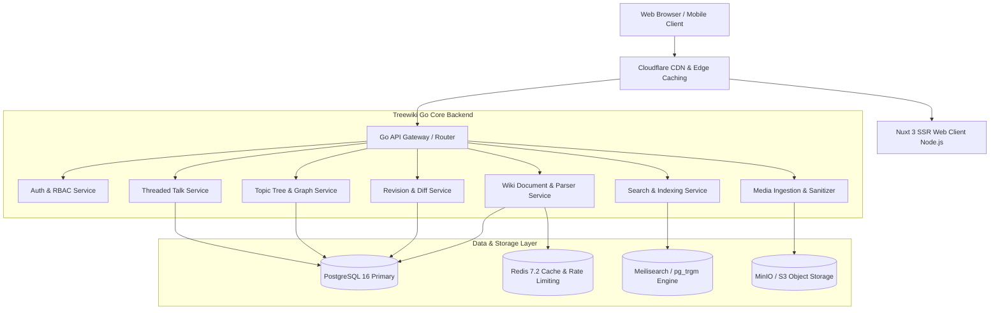

# Treewiki Architecture & Technical Specification

## 1. System Overview & C4 Model

Treewiki is structured as a modern High-Performance Modular Monolith backend in Go paired with an SSR-optimized Vue 3 / Nuxt 3 web client.

---

## 2. Core Subsystem Architectural Details

### 2.1 Unified Wiki AST Parser Engine
The parser receives raw wikitext/markdown and executes a multi-phase compilation:
1. **Lexical Tokenization**: Identifies wiki tags (`[[Link]]`, `{{Template}}`, `<ref>`, `== Heading ==`, Markdown `#`, `**bold**`).
2. **Template Expansion**: Recursively resolves parametric templates and infoboxes with recursion depth limit protection.
3. **AST Construction**: Builds a unified abstract syntax tree representing blocks, spans, and metadata directives.
4. **HTML Sanitization (Security)**: Bluemonday / DOMPurify strips unsafe attributes and tags.
5. **Output Generation**: Produces HTML content, extracted headings (for TOC), footnote registry, and outgoing link index.

### 2.2 Revision Storage & Conflict Resolution
- Every edit creates an immutable row in `revisions`.
- Revision text is stored in `revision_text` with compression (zstandard for historical revisions).
- Concurrent edits are evaluated via Optimistic Concurrency:
  - If target parent revision matches current latest revision: Clean fast-forward append.
  - If someone else edited concurrently: 3-way line merge algorithm evaluates non-overlapping diffs. Overlapping lines trigger an Edit Conflict UI with visual side-by-side reconciliation.

### 2.3 Topic Tree DAG (Directed Acyclic Graph)
- Topics are stored as nodes (`topic_nodes`) and edges (`topic_edges`).
- Traversal queries use PostgreSQL Common Table Expressions (`WITH RECURSIVE`) to retrieve ancestor and descendant topic chains.
- Prevents cyclic dependencies using topological cycle detection on edge insertion.

