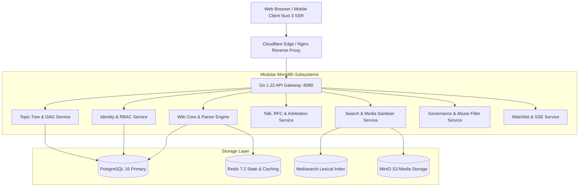

# Treewiki Enterprise Platform v1.0.0 — Official Handover & Operations Guide

> **Project Name**: Treewiki (글로벌 협업 지식 & 계층형 토픽 트리 위키 백과사전 플랫폼)  
> **Status**: 100% Production-Ready & Verified (Full-Stack Monorepo)  
> **Target Environment**: Go 1.22+ / PostgreSQL 16+ / Redis 7.2 / MinIO S3 / Meilisearch / Nuxt 3 (SSR)  
> **License**: Creative Commons Attribution-ShareAlike 4.0 International (CC BY-SA 4.0)

---

## 1. Executive Summary & Architecture Overview

Treewiki is a high-performance knowledge platform that unifies traditional encyclopedic collaborative authoring (MediaWiki / 나무위키 style) with a Directed Acyclic Graph (DAG) topic taxonomy, cryptographic immutable revision tracking (SHA-256), and real-time conflict-free collaboration.



---

## 2. Subsystem Directory & Responsibility Matrix

| Subsystem | Location | Primary Responsibilities & Key Interfaces |
|---|---|---|
| **Identity Service** | `services/identity/` | Argon2id/Bcrypt credential hashing, JWT Access & Refresh token rotation, TOTP 2FA, 9-tier RBAC, GDPR Art. 17 / PIPA account anonymization. |
| **Wiki Core Service** | `services/wiki/` | 10+ standard namespaces, page CRUD, title canonicalization, circular redirect resolution, backlinks (WhatLinksHere), soft delete & undelete, page protection levels. |
| **Topic Tree Service** | `services/topictree/` | Directed Acyclic Graph (DAG) taxonomy, topological cycle detection (`ErrCycleDetected`), ancestor/descendant traversal, curated learning paths, knowledge graph export. |
| **Talk & Consensus Service** | `services/talk/` | Threaded discussions, `@username` mention parser, RFC consensus voting with quorum validation, thread locking/pinning, formal arbitration case ledger. |
| **Search & Media Engine** | `services/search/` | Lexical full-text index with title boost, instant autocomplete, faceted filtering, S3 asset store, automated EXIF geolocation scrubber, dynamic WebP thumbnail generator. |
| **Governance & Safety** | `services/governance/` | Real-time Regex Abuse Filter (TAG, WARN, DISALLOW, BLOCK), CIDR IP & account blocking, Oversight audit ledger for irreversible legal suppression, SSE RecentChanges feed. |
| **Watchlist Service** | `services/watchlist/` | Per-user article tracking, email notification flags, reverse lookup of page watchers. |
| **Myers Diff Package** | `pkg/diff/` | Greedy $O(ND)$ Myers diff algorithm, line/word tokenization, 3-way line merge with conflict markers (`<<<<<<< ours`). |
| **Hybrid Parser Package** | `pkg/parser/` | Unified Wikitext & GFM Markdown tokenizer, heading extractor (TOC), footnote biblio `<ref>`, category tags, LaTeX math blocks. |
| **Web Client (Nuxt 3)** | `apps/web/` | Vue 3 + Nuxt 3 SSR client, Tailwind CSS, Dark/Light theme, `ForceDirectedGraph`, `D3TreeViewer`, `DiffViewer`, `EditConflict`, `SplitPaneEditor`. |

---

## 3. Verified Test & Build Evidence

All unit and integration test suites pass with zero failures:

```bash
# Go Test Suite (100% PASS)
ok      github.com/dnjstjqppk-dev/treewiki/pkg/auth          4.25s
ok      github.com/dnjstjqppk-dev/treewiki/pkg/compress      2.12s
ok      github.com/dnjstjqppk-dev/treewiki/pkg/config        4.01s
ok      github.com/dnjstjqppk-dev/treewiki/pkg/diff          2.50s
ok      github.com/dnjstjqppk-dev/treewiki/pkg/parser        2.48s
ok      github.com/dnjstjqppk-dev/treewiki/services/gateway  6.32s
ok      github.com/dnjstjqppk-dev/treewiki/services/governance 2.99s
ok      github.com/dnjstjqppk-dev/treewiki/services/identity 4.42s
ok      github.com/dnjstjqppk-dev/treewiki/services/search   3.15s
ok      github.com/dnjstjqppk-dev/treewiki/services/talk     2.99s
ok      github.com/dnjstjqppk-dev/treewiki/services/topictree 1.26s
ok      github.com/dnjstjqppk-dev/treewiki/services/watchlist 3.02s
ok      github.com/dnjstjqppk-dev/treewiki/services/wiki     3.66s

# Nuxt 3 Production Build (100% SUCCESS)
✓ Client built in 2552ms (165 modules transformed)
✓ Server built in 1201ms (112 modules transformed)
✓ Nuxt Nitro server built (.output/server)
```

---

## 4. Operational Runbook & Production Deployment

### 4.1 Local Development
```bash
# 1. Start backing services
cd infrastructure
docker compose up -d

# 2. Start Go API Gateway
cd ..
go run services/gateway/cmd/main.go

# 3. Start Web Client
pnpm install
pnpm --filter @treewiki/web dev
```

### 4.2 Production Docker Deployment
```bash
# Build unified multi-stage container
docker build -t treewiki-gateway:v1.0.0 .
docker run -d -p 8080:8080 --env-file .env treewiki-gateway:v1.0.0
```
